# Shotlin pipeline: from a customer's requirement to an APK

The plan for how Opscode takes a customer's request and builds the app with a team of agents. You choose how much power (and money) each project gets with one of three **modes**. You approve at fixed points, and you can watch every step live.

Example customer: *"A grocery app. Every Friday, a fish auction users can bid in. Multi-vendor. Loyalty points. Here is my requirements file."*

---

## 1. The three modes

| | **GODMODE** | **WARLORD** | **SHINOBI** |
|---|---|---|---|
| In one line | Ultimate multi-agent, full power, full-stack thinking | Strong development, balanced intelligence | Stealthy, efficient, low cost, fast |
| Use it for | Big new apps, paying clients, complex systems | Most projects | Small features, fixes, prototypes |
| Agents at once | 4–6 (planner, architect, builders, UI, reviewer, tester) | 2–3 (planner, builder, UI) | 1–2 (one big prompt playing several roles, plus skills) |

**Models: who uses what**

| Job | GODMODE | WARLORD | SHINOBI |
|---|---|---|---|
| Plan making | **Opus 5.5** | **Opus 5.5** only when the project is complex; otherwise Sonnet 5.5 | **Opus 5.5** only sometimes (big plans); otherwise Sonnet 5.5 medium |
| Complicated functions (payments, auction logic, data, security) | **Opus 5.5** | Sonnet 5.5 high | Sonnet 5.5 medium |
| Normal functions | **Sonnet 5.5 medium** | Sonnet 5.5 medium | Sonnet 5.5 medium |
| Small chores (search files, summaries, commit messages, run tests, read logs) | Haiku 5.5 | **Haiku 5.5** | Haiku 5.5 |
| **UI and images** | **Codex** (and ChatGPT image generation) | **Codex** | **Codex** |
| Review | Opus 5.5, every feature | Sonnet 5.5, every milestone | Sonnet 5.5 low, at the end |
| Tests | Codex writes them, Haiku runs and reads results | same | same |

**The same steps in every mode.** All three run the full pipeline below: intake, spec, gap report, plan, UI loop, build, **review**, test, APK. The mode only changes the models, how many agents work at once, how many UI refinement rounds there are (3 / 2 / 1), how deep the tests go, and the budget. Switching modes mid-project is safe.

**Escalation.** If a cheaper model fails a task twice (tests still fail, or the reviewer rejects it), that task alone moves one step up: Haiku → Sonnet → Opus. The rest of the project stays on the mode's models.

**Mode cards.** No glowing frame and no stat tables. One big pixel character in a real pose per mode (Shinobi crouched with his blade, scarf in the wind, shining), the name, and one line.

### Cost rules, from your real usage

These come from your last 30 days of Claude Code and Codex use (see `docs/usage-report.md`):

1. **A fresh chat for every task.** Today the average Claude call carries **~434k tokens** of conversation. About **60% of all usage is the model re-reading that history**. Every pipeline task runs in its own short chat, and the next task gets a short hand-off note, not the whole history. Keeping chats under ~150k tokens would have saved **about 40%** of last month's usage.
2. **Hand off before 150k.** When a chat passes ~150k tokens, it writes a summary and a fresh chat continues.
3. **Haiku for chores.** Right now Haiku is almost unused (0.01%). Searching, summarising, running tests and reading logs move to Haiku.
4. **Codex takes UI, images and tests.** Your Codex weekly limit peaked at 69%, so it has room. Its 5-hour window does fill up in bursts (96% on 12 Nov), so the scheduler spreads Codex work out.
5. **Limit-aware scheduling.** The pipeline watches both plans' limits (the Usage page). If Claude's 5-hour window passes 80%, non-urgent work waits for the refill or moves to Codex. Nothing is cut off mid-task.
6. **Lean mode on.** Claude Code workers start without your MCP servers unless a task needs one; each server adds tens of thousands of tokens to every request.

---

## 2. The pipeline

```mermaid
flowchart LR
  A[Customer requirement<br/>text + PDF/DOC/MD/images] --> B[1. Intake<br/>read files, ask only what's missing]
  B --> C[2. Requirement spec<br/>features + acceptance checks]
  C --> D[3. Match your apps<br/>grocery, meat, e-commerce, laundry]
  D --> E[4. Gap report<br/>have / change / new]
  E --> F[5. Plan + diagrams + cost]
  F -->|you approve| G[6. UI loop<br/>Claude brief → Codex screens → Claude review]
  G -->|you approve| H[7. Build, feature by feature<br/>Claude = logic, Codex = UI/small]
  H --> I[8. Test bot<br/>API + button clicks + reports]
  I --> J[9. APK to you]
  J -->|feedback| H
```

### 1. Intake
- The customer's message and files go in: PDF, Word, Markdown, images, screenshots.
- Opscode reads everything first. It asks a question **only if the files don't already answer it** (for example "Who sets the auction's starting price, the vendor or the admin?").
- GODMODE interviews fully, WARLORD asks the key questions, SHINOBI asks only blockers.

### 2. Requirement spec
- One file, `requirements.md`, holds every feature with an ID, a short description, and **acceptance checks** (what "done" means).
- Example: `F-07 Friday fish auction: opens Friday 6 AM, bids in ₹10 steps, the highest bid wins at 9 PM, the winner pays within 30 minutes.`
- In GODMODE it is also exported as a PDF for the customer.

### 3. Match your existing apps (the Library)
- Your apps (grocery, meat selling, e-commerce, laundry) are **indexed once**, then updated on each new commit.
- For each app Opscode keeps a **feature map**: feature → screens, APIs, database tables and files. It also keeps a code graph of what calls what.
- The Chief checks what kind of app the customer wants ("this is a grocery app") and picks the closest base app. It then searches the other apps for any missing parts (for example, the e-commerce app already has vendor payouts).

### 4. Gap report
For every feature in the spec, the report gives one answer:

| Feature | Status | Where |
|---|---|---|
| Cart and checkout | **Have** | grocery app: `lib/cart/`, `api/orders` |
| Multi-vendor | **Have, with changes** | e-commerce app: `vendors/`, needs per-vendor stock |
| Loyalty points | **Have** | meat app: `loyalty/` |
| Friday fish auction | **New** | not in any app |

You see clearly what is reused, what changes, and what is built new. This is where most of the time and money is saved.

### 5. Plan, diagrams and cost
- **The plan:** milestones, a task list, and which engine does each task.
- **Diagrams** (drawn in Opscode): architecture, database (ER), user flows, and the auction sequence.
- **Cost estimate:** tokens and money per milestone for the chosen mode, checked against your live Claude and Codex limits on the Usage page.
- **You approve here.** Nothing gets built before your OK.

### 6. UI loop
1. Claude writes a UI brief per screen: layout, states, your brand.
2. Codex makes the screens and images (ChatGPT image generation for illustrations, icons and banners).
3. Claude reviews them against the brief and sends back fixes (up to 3, 2 or 1 rounds depending on the mode).
4. **You see a gallery of screens and approve**, or comment on a screen to change it.

### 7. Build, feature by feature
- One feature at a time, each on its own git branch.
- **Claude Code** does the hard parts: auction logic, payments, data, APIs.
- **Codex** does UI wiring, simple screens and small tasks.
- Reused code is copied from your Library apps first, then adapted.
- A reviewer checks every change for broken rules: lint, types, security, your coding rules and the spec's acceptance checks.

### 8. Test bot (like a professional QA team)
- **API tests:** every endpoint, including bad inputs (bid lower than the current bid, an auction that is already closed).
- **UI bot:** opens the app on the Android emulator and taps through real flows (sign up, add to cart, bid in the auction, redeem points).
- **Exploratory bot (GODMODE):** taps around like a curious user and reports crashes and odd screens.
- **Report:** what passed, what failed, with screenshots and a short video. Failures go back to step 7 automatically.

### 9. APK to you
- Builds the release APK and sends it to you.
- You install it, test it, and send feedback (text, voice or screenshots).
- Each piece of feedback becomes a small change request. The loop repeats until you approve the release.

---

## 3. You stay in control: the Observer

- **Pipeline board:** every project with its current step (Intake → Spec → Gap → Plan → UI → Build → Test → APK).
- **Approvals inbox:** the plan, the UI gallery, and each APK wait here for your OK.
- **Every agent is a real chat:** open any one and see what it's doing, step in, or stop it.
- **Cost meter:** tokens and money per project and per mode, plus your Claude and Codex limits (the Usage page you already have).
- **Timeline:** what happened and when, so you can check that every step was done properly.

---

## 4. What Opscode already has, and what to build

**Already built:**
- **Chief:** board, worker chats, crew rules.
- **Automations:** steps, approval gates, checks, retries, model tiers, budgets.
- **Engines:** Claude Code and Codex, both working.
- **Live usage limits:** the Usage page.
- **Supporting tools:** model picker, MCP servers, computer use, browser and file panels.

**To build, in this order** (each phase is small, tested, and shown to you before the next):

| # | Phase | What you get |
|---|---|---|
| 0 | **Measure** | Usage → "Where tokens go" per project and session, so the benchmark can be run (see `docs/token-optimization-plan.md`) |
| A | **Modes + Conductor/workers** | GODMODE / WARLORD / SHINOBI presets (models per job, agents, review, tests, budget, escalation, hand-off at 150k) + the character cards |
| B | **Library** (DONE) | Index your existing apps → feature maps + code graph. Built: folder or one-click add, no model tokens, secrets never read, 7 RPCs, a read-only Chief tool `library_search`, a Library page. Next: D (gap report) uses it. |
| C | **Intake + spec** | Reads PDF/DOC/MD/images; asks only what's missing; writes `requirements.md` |
| D | **Gap report + plan** | Have / change / new table, diagrams, cost estimate, approval gate |
| E | **UI loop** | Claude brief → Codex screens and images → Claude review → your gallery approval |
| F | **Build loop** | Feature-by-feature branches, reuse from the Library, rule checks |
| G | **Test bot** | API tests, emulator button-click tests, reports with screenshots and video |
| H | **APK delivery + feedback** | Release build, delivery to you, feedback → change requests |
| I | **Observer** | Pipeline board, approvals inbox, cost meter, timeline |

Order: 0 and A first (everything uses the modes), then B (the gap report needs the Library). After that each phase plugs into the one before.

---

## 5. Decisions needed from you

1. **App stack:** what are the grocery and meat apps built with (Flutter, React Native, Kotlin)? This decides how the APK is built and how the UI bot taps through the app.
2. **Your apps' repos:** which GitHub repos to index for the Library (grocery, meat, e-commerce, laundry). Private repos need the GitHub CLI (`gh`) or a token.
3. **APK delivery:** inside Opscode only, or also Telegram/WhatsApp or Firebase App Distribution?
4. **Your planning way:** if you have a plan format you like (a sample doc or a screenshot), send it and the plan maker will write every plan in that format.
