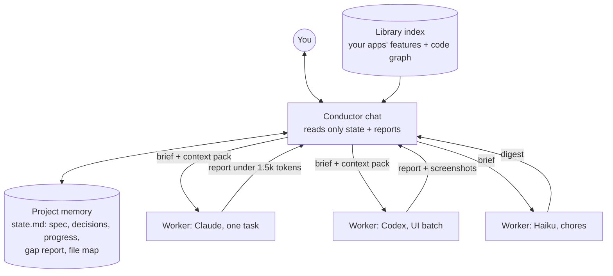

# Why tokens burn, and how Opscode stops it

Built from every Claude Code and Codex session on this Mac in the last 30 days (16 Oct – 15 Nov 2026): 99 Claude sessions, 25,928 model calls, and 367 Codex sessions in the last week. Nothing left this Mac.

"Usage value" means what the tokens would cost at API list prices. It's the fair way to compare before and after; it's **not** your bill (you're on Claude Pro and ChatGPT Team, where the same waste shows up as hitting limits sooner).

---

## 1. What I found: the six burners

| # | What happens today | Your numbers | Usage value |
|---|---|---|---|
| 1 | **One chat per project for days.** You keep working in the same chat for days. | 27 of 99 sessions ran across several days, and they are **70% of all usage**. The biggest: Project_opslin, 17–24 Oct, 3,152 calls, 258 messages. | biggest cause |
| 2 | **Every message re-reads the whole history.** The chat grows to 500k–965k tokens (the 1M window), then compacts and keeps going. | Average call carries **434k tokens**; 81% of calls carry over 200k. | ~60% of everything |
| 3 | **A heavy starting prompt.** All plugins, skills and MCP tool lists load before you type. | Median **98k tokens** at the start of a session (90th percentile 132k), re-read on every call. | **$442 (22%)** |
| 4 | **Tool output stays in the chat forever.** Server logs, build output, browser pages and screenshots are carried into every later message. | Bash output 33M characters, MCP and browser output 19M, Read 7.7M, **2,798 screenshots/images**. | ~$776 carried along |
| 5 | **The cache is rebuilt from scratch.** It happens after a break of more than 5 minutes, or when the model changes inside the same chat (Opus ↔ Sonnet). | 150 full rebuilds: after breaks $155, model switches $89, other $39. | **$283 (14%)** |
| 6 | **Expensive models on small steps.** Opus or Fable runs tool steps that write under 300 tokens. | 1,936 Opus calls, 157 Fable calls. | ~$47 |

These overlap: a long chat makes every one of them worse. The re-costing in section 3 counts each token once.

**Codex has the same habit, at small scale:**
- 367 sessions in 7 days (244 of them `codex exec` one-offs).
- **325 wrote less than 2k tokens**, and the median wrote **194 tokens**, yet every session first read about **27k tokens** of start-up prompt.
- Many tiny separate sessions means you mostly pay the start-up cost.

**Disk:** 10.7 GB of logs and worktrees.
- `~/.claude/projects` 3.7 GB
- `~/.codex/sessions` 4.0 GB
- `~/.caveman-code` 3.0 GB, of which 2.6 GB is old worktrees

What's **not** a problem: your model choice is already sensible. Sonnet 5.5 at medium effort does 79% of the work, and only 21% of calls run at high effort.

---

## 2. The fix: one Opscode chat for you, many short workers inside

### Two ways to work: Normal chat and Conductor

| | **Normal chat** (as today) | **Conductor** (only when you pick a mode) |
|---|---|---|
| What it is | You and one model, chatting directly | A project leader that runs a team of short workers for you |
| How you start it | New chat → pick a model (Claude Code, Codex, an API key) → type | New chat → pick **GODMODE / WARLORD / SHINOBI** |
| Good for | Bugs, quick changes, questions, exploring, anything manual | Building a whole app or a big feature end to end |
| Who does the work | That one model, the way you steer it, with its own tools, skills and settings | Many short workers (Claude for logic, Codex for UI and images, Haiku for chores); you talk only to the Conductor |
| Looks like | The normal chat look | Its own look: a shiny pixel mode emblem in the mode's colours on the chat, in the sidebar and in the header, so you always know which kind of chat you're in |

Nothing about Normal chat changes. The modes are an extra choice, never forced. Normal chats can optionally get one small helper: when a chat passes ~150k tokens, Opscode offers "continue in a fresh chat with a summary". You decide; it never happens on its own.

### How the Conductor works

When you start a mode, that chat becomes the **Conductor** for the project. Behind it, Opscode runs many **short, single-task workers** on Claude Code and Codex, and closes each one when its task is done. You never pay for a long history again.

**The rules every mode follows:**

1. **A fresh worker for every task.** Each worker gets a brief and a **context pack**: the exact files and functions it needs, picked from the Library index. That replaces exploring the repo with Grep and Read. It returns a short report and closes. *(Fixes 1 and 2.)*
2. **Hand-off before 150k.** If a worker grows past ~150k tokens, it writes a hand-off note and a new worker continues from it. Most tasks finish under 80k. *(Fixes 2.)*
3. **Lean start.** Workers start with about 25k tokens: no MCP servers, no unrelated skills, only the tools the task needs. A task that needs one server, such as Supabase or a browser, gets just that one. *(Fixes 3.)*
4. **Small tool outputs.** *(Fixes 4.)*
   - **Logs:** test, build and server logs go to a **Haiku digest**, which keeps only failures and error lines. The worker sees about 1k tokens instead of 50k.
   - **Screenshots:** only UI tasks take them, at small size, and only the last two stay in the chat.
   - **File reads:** files are read in ranges. Build folders, lockfiles and `node_modules` are never read.
5. **Cache discipline.** *(Fixes 5.)*
   - One model per worker. If a task needs Opus, it gets a new Opus worker; the model never switches inside a chat.
   - Workers run straight through without waiting on you mid-task. The Conductor collects your answers between tasks.
   - Workers in the same role share an identical start, so the cache is reused across them.
6. **The right model for each job.** Your mode table: Opus for plans and complex functions, Sonnet 5.5 medium for normal work, Haiku for chores, Codex for UI and images. *(Fixes 6.)*
7. **Codex batching.** One Codex app-server per project. UI work goes into one thread per screen group (resumed, not restarted), so ten small UI fixes cost one start-up, not ten. The queue watches Codex's 5-hour window and spreads work out.
8. **Limit-aware queue.** Opscode reads both plans' limits (the Usage page). Above 80% of Claude's 5-hour window, work that isn't urgent waits for the refill or moves to Codex. Nothing is cut off mid-task.
9. **Clean up as you go.**
   - A worker's worktree is deleted once its branch is merged.
   - Transcripts older than 14 days are compressed, and those older than 60 days are deleted unless pinned.
   - Codex session logs follow the same rule.
   - Opscode shows disk use on the Usage page. Nothing is deleted without your OK the first time.

**How the three modes use this:**

| | GODMODE | WARLORD | SHINOBI |
|---|---|---|---|
| Conductor | Sonnet 5.5 medium | Sonnet 5.5 medium | Sonnet 5.5 medium |
| Plan | Opus 5.5 worker | Opus only if the project is complex, else Sonnet | Sonnet 5.5 medium (Opus for big plans) |
| Complex functions | Opus 5.5 workers | Sonnet 5.5 high | Sonnet 5.5 medium |
| Normal functions | Sonnet 5.5 medium | Sonnet 5.5 medium | Sonnet 5.5 medium |
| Chores and log digests | Haiku 5.5 | Haiku 5.5 | Haiku 5.5 |
| UI and images | Codex | Codex | Codex |
| Workers at once | up to 4 | up to 2 | 1 |
| Review | Opus, each feature | Sonnet, each milestone | Sonnet low, at the end |

The Conductor stays on Sonnet in every mode because it only reads short reports and the project memory, so it stays small. The expensive thinking happens in short Opus workers that close when done.

**A project in 3–4 days:**

| Day | What runs | You |
|---|---|---|
| 1 | Intake → spec → Library match → gap report → plan + diagrams (about 6–10 workers) | Answer questions, approve the plan |
| 1–2 | UI loop: Codex screen batches, Claude review (about 4–8 workers) | Approve the UI gallery |
| 2–3 | Build, feature by feature (one worker per feature; 1–4 in parallel by mode) + Haiku test digests | Look in when you like |
| 4 | Full test bot run, fixes, release APK | Test the APK and send feedback |

---

## 3. Before and after

**Measured on your real month.** I re-costed all 25,928 calls with rules 1–6, assuming the same work and the same output; only the waste is removed:

| Step | Saves |
|---|---|
| Lean start prompt | 18% |
| Fresh short chats + small tool outputs | 26% |
| No needless cache rebuilds | 12% |
| Right model per job | 2% |
| **Total** | **58%: $2,003 → $834** |

| Project (30 days) | Before | Same work, new rules |
|---|---|---|
| Project_opslin | $1,004 | $343 |
| dealker X shotlin | $492 | $232 |
| Lndry X Shotlin | $142 | $81 |
| Bakaloo X Shotlin | $121 | $64 |
| opscode | $121 | $60 |

**Projected, from the pipeline itself** (to be proven by the benchmark):

- **Library reuse:** existing features are copied from your apps instead of re-explored and rebuilt. Expected to cut build work 30–40% when a base app exists.
- **Codex takes UI and images:** about 20% of build work moves off Claude.
- **Spec first, tests as the finish line:** fewer "fix it again" rounds. Today a session has a median of 9 messages, and up to 258.

**Expected cost of a project that cost about $400 before:**

| Mode | Estimate | Why |
|---|---|---|
| SHINOBI | **~$40–60** | 1 worker, Sonnet medium, light review |
| WARLORD | **~$60–100** | 2 workers, Opus only for complex plans |
| GODMODE | **~$120–160** | Opus plans, complex code and reviews, deeper tests; still about 60% under today |

In other words, waste goes from roughly 50–60% of what you spend today to under 10%.

---

## 4. Benchmark: prove it

1. **Choose one real past project** with a known cost, for example a Lndry or Bakaloo feature set, and write its requirement once.
2. **Run it in each mode** in Opscode, on a fresh branch.
3. **Measure each run** with the same analysis used here, which becomes an Opscode feature: Usage → Projects.
   - Usage value
   - Claude and Codex limit % used
   - Hours from start to APK
   - Test pass rate
   - How many times you had to step in
4. **Pass if:**
   - WARLORD comes in at under 30% of the old cost,
   - with the same features passing their acceptance checks,
   - and with no more interventions from you than before.

---

## 5. Changes to the build order

- **Phase 0 (new): Measure.** The analyser from this report becomes part of Opscode: Usage → "Where tokens go", per project and per session. It's needed to run the benchmark.
- **Phase A grows:** the modes, plus the Conductor/worker rules (fresh worker per task, context packs, lean start, the 150k hand-off, log digests, one model per worker, Codex batching, limit-aware queue, cleanup).
- Phases B–I stay as in `docs/shotlin-pipeline-plan.md`.
