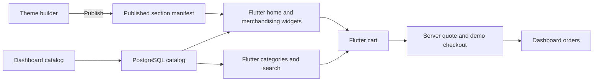

# Commerce modules

## Run the bundled Fresh Basket storefront

From the skill directory:

```bash
python3 scripts/assemble.py /path/to/new/fresh-basket --profile commerce --brand "Fresh Basket"
cd /path/to/new/fresh-basket
python3 run_local.py
```

The generated project needs Python 3, Node.js with npm, Flutter, and PostgreSQL tools on PATH. Run `python3 run_local.py --flutter /path/to/flutter/bin/flutter` if necessary. Use `--offline` when the npm and Pub caches contain the locked dependencies. The runner creates an isolated PostgreSQL database under `.local`, applies the bundled migrations, and opens loopback services.

1. Open [Catalog](http://127.0.0.1:4501/catalog). Add a product with a price, stock, unit, category, and optional photo.
2. Open the [Flutter storefront](http://127.0.0.1:4502). Tap **Browse**, select the category and use the **+** on the product card. Open the top cart, review the server quote and choose **Cash on Delivery**. Tap **Place demo order** on the next screen.
3. Find the same order number, items, and amount on the [Orders dashboard](http://127.0.0.1:4501/orders). The catalog reflects the stock decrement. Cash on delivery is simulated for the demo customer.

## Bundled source index

Paths in this table are relative to this skill's root. The Flutter port uses the snapshot recorded in [sources.json](sources.json). The commerce profile overlays its screen and API files onto the shared homepage and editor bundles.

| Module | Bundled implementation |
|---|---|
| Header, search and carousel | `modules/mobile-home/source/lib/shared/widgets/home_search_bar.dart` and `modules/mobile-home/source/lib/features/home/presentation/screens/home_sections.dart`. Commerce supplies `lib/shared/widgets/home_header.dart` with a cart badge, and `lib/features/home/presentation/screens/home_screen.dart` with live catalog wiring. |
| Categories and navigation | `modules/commerce/source/flutter/lib/features/categories/presentation/screens/categories_screen.dart` ports Bakaloo's two-pane layout, category rail, product grid and compact add buttons. See `lib/shared/widgets/storefront_navigation.dart` and `storefront_icon_button.dart` for the shared navigation and assets. |
| Cart and checkout | `modules/commerce/source/flutter/lib/features/cart/` includes Bakaloo's delivery header, item cards, swipe removal and payment footer. `lib/features/checkout/` carries the checkout bill and confirmation. `lib/commerce/commerce_client.dart` connects both screens to the same local API. |
| Homepage merchandising | `modules/commerce/source/flutter/lib/features/home/presentation/widgets/` includes the manifest adapter, product grids and rails, seasonal mosaic, promo carousel, category icons and offers strip. `lib/shared/widgets/arched_product_card.dart` and `arched_product_layouts.dart` hold the arched showcase variants. The editor and publication pipeline come from `modules/theme-builder/source/`. |
| Artwork | `modules/mobile-home/source/assets/` contains reusable Bakaloo art, fonts and icons. `modules/commerce/source/flutter/assets/commerce/` contains the Fresh Basket photo banner, category art, grocery product photos and a local Bakaloo animation. `modules/commerce/source/storefront.json` selects the demo media and names. |
| Catalog and orders backend | `modules/commerce/source/backend/src/modules/commerce/` exposes the local catalog, checkout quote, order creation and staff reads. It uses Bakaloo's totals engine, PostgreSQL migrations and guarded stock decrement. |
| Staff dashboard | `modules/commerce/source/dashboard/src/app/catalog/page.tsx` and `src/app/orders/page.tsx` show products and orders from the same database. |



The commerce editor exposes all 13 Bakaloo section types. Product blocks resolve manual, category and tag selection against the local catalog. The single-store preview uses local media uploads and bundled motion assets. It exercises cash-on-delivery checkout with the demo customer, with simulated wallet and notifications. Production payment, scheduled delivery, remote media and external campaign links require the corresponding production adapters.

Run `npm run test:e2e -- checkout.spec.ts merchandising.spec.ts --workers 1` from the generated dashboard against the running services. Set `PLAYWRIGHT_CHROMIUM_EXECUTABLE` when using an installed Chrome binary. The tests publish merchandising sections into an open Flutter app, create a product, order it through Browse and Cart, and verify the same order and one stock decrement in the dashboard.

## Source recipes

Read the selected recipe and inspect its group paths before choosing a data model. The source supports store-scoped and audience-specific behavior. Decide whether the destination is single-store, multi-store, B2C, B2B or mixed, using the user's requirements.

| Workflow | Source and checks |
|---|---|
| Catalog and inventory | Backend product, category and shop-product routes and repositories, dashboard product and store inventory pages, Flutter catalog and search. Exercise product visibility, variant or pack size, price, unit of sale, stock and audience with the same fixtures in both clients. |
| Cart and checkout | Backend `src/modules/cart/totals-engine.service.js`, `bill-summary.service.js`, `src/modules/orders/`, Flutter cart and checkout. Use server totals and eligibility. Verify taxes, fees, discounts, stock reservation and order creation within their intended boundaries. |
| Orders and fulfillment | Backend order, delivery, allocation and shop order modules, dashboard staff order pages and Flutter history and tracking. Verify user and store ownership, allowed status transitions, retries and cancellation with expected stock outcomes. |
| Payments and money | Backend payments, settings, refunds, wallet and ledger, Flutter payment adapter and dashboard refund operations. Use test providers. Verify amount and currency on the server and handle duplicate callbacks, partial failures and reconciliation with idempotent state transitions. |
| Extensions | Pick the explicit promotions, B2B, POS, ERP, messaging or store-operations recipe. Check each extension's DB changes, permissions, background work, and which flows depend on its data. |

In a fresh grocery-core test, create an available product in the dashboard, browse it in Flutter, add it to the cart, quote totals, place an order, and find it with the correct store and status in the dashboard. Verify that quantity and inventory change as expected even under a duplicate submit or a competing checkout. Test cancellation and restoration if offered. Exercise service-area rejection and payment failure if those features are selected.

Start from backend `tests/unit/cart/`, `tests/property/order-checkout-atomicity.property.test.js`, `tests/integration/concurrent-stock.test.js`, and dashboard `e2e/shop-products-live.spec.ts`. Inspect each test's fixture and environment before running it. For changed policies, add a focused scenario that proves the new behavior with a controlled dataset.
