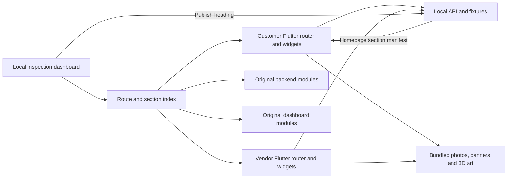

# Velo Devices Flutter demo

Run both bundled Flutter apps from a fresh folder. The launcher builds JavaScript Flutter Web outputs, starts the fixture API and inspection dashboard, and serves everything from one loopback port. The demo needs Python 3, Node.js, and a Flutter SDK compatible with both bundled lockfiles. Add `--offline` to use a populated Pub cache or `--flutter /path/to/flutter` to select an SDK. Use `python3 run.py --reuse-build` to restart the local server after a successful build.

```bash
python3 scripts/full_demo.py /tmp/velo-devices --port 5010
cd /tmp/velo-devices
python3 run.py --offline
```

| View | Open locally | What to inspect |
|---|---|---|
| Screen library | [Dashboard](http://127.0.0.1:5010/) | 61 customer route definitions, 85 vendor route definitions, 27 customer section renderers, and both home layouts |
| Customer | [Home](http://127.0.0.1:5010/customer/#/home) | Delivery area, store switcher, subcategory tabs, search, promotions, category and product cards, and bottom navigation |
| Customer repair | [Repair home](http://127.0.0.1:5010/customer/#/repair), [Quotes](http://127.0.0.1:5010/customer/#/repair/demo-repair/quotes) | Repair issues, request form, quote cards, appointments, and tracking |
| Vendor | [Home](http://127.0.0.1:5010/vendor/#/home) | Header and stats, quick actions, demand, needs action, cart, live auctions and campaigns, wholesale feed, and bottom navigation |
| Vendor operations | [Wholesale](http://127.0.0.1:5010/vendor/#/wholesale), [Repair inbox](http://127.0.0.1:5010/vendor/#/repairs), [Orders](http://127.0.0.1:5010/vendor/#/orders) | Inventory and buying, incoming repair jobs, and order queues |

## How to find and reuse the code



Paths below start at `modules/full-demo/`.

| Layer | Path | How an agent uses it |
|---|---|---|
| Screen and dependency index | [source/dashboard/index.json](../modules/full-demo/source/dashboard/index.json) | Read `roles` for links and router source lines, `sections` for renderer entry points and dependencies, `home_slots` for fixed home widgets, and `areas` for the original backend and dashboard pairings. Regenerate it with `scripts/index_full_demo.py` after router changes. |
| Original customer UI | `source/customer/lib/features`, `source/customer/lib/core/theme` | Start with the route, trace its state and repository, then bring the existing widgets, styles and asset registrations together. |
| Original vendor UI | `source/vendor/lib/features`, `source/vendor/lib/shared` | Trace the original screen, data adapter and shared widgets. The home composition is in `features/home/home_screen.dart`. |
| Flutter artwork and animation | `source/customer/assets`, `source/vendor/assets` | Keep the existing asset paths and image dimensions. The app pubspecs declare which images and fonts ship with each role. |
| Server media and demo data | `source/service/media`, `source/service/fixtures`, `source/service/demo-api.mjs` | Use the product fixtures, repair records and real section manifest shapes to exercise the original UI. |
| Original backend source excerpts | `integration/backend/src/modules` | Follow the real routes, controllers, services and repositories recorded under each area. Resolve authentication, database and common imports from the destination's backend. |
| Original web dashboard source excerpts | `integration/dashboard/src` | Inspect the Next.js editor, dashboard pages and previews. Follow the dependency paths for the screen you select. |
| Local runner and inspection UI | `source/run.py`, `source/dashboard`, `source/service/server.mjs` | Run or inspect Flutter, open a screen directly, or publish a text-header change and see the original Flutter renderer use it. |

Customer snapshot basis `7cd6a1a`, vendor `bc85f1e`, backend `5bfbd04`, dashboard `9cc0378`. The assembler wires local sessions, app branding and API endpoints into the Flutter snapshots. The original backend and Next.js excerpts are available for integration work. The running dashboard and service use the local demo implementation.

## Section changes

1. Find the section key in the JSON index. Extract the builder, section widget, data parsing and relevant helpers together.
2. Keep the dashboard config and backend manifest aligned with the keys read in the widget. Use the seller, inventory and variant fields consumed by the original card.
3. Use the local image paths when assembling. Ten product photos came from the public catalog and 35 merchandising images came from the original backend seed assets. The fixture uses category artwork when it lacks a product photo. Original artwork can still contain the original brand.
4. Inspect the original renderer by opening it in **Sections** or by visiting `/customer/#/demo/section/<key>`. Check the same component in the surrounding home layout too. Vendor home rows in the index link to the composed screen and list each widget's source.
5. Preview publication by editing **Homepage heading** and choosing **Publish to demo**. The server updates the section manifest and the dashboard reopens the actual Flutter text-header renderer.

## Demo behavior

The service uses synthetic account, address, and transaction records. It keeps cart, publication and submitted repair data in memory. Restarting the service resets those records. Web-only platform placeholders and routes that depend on unavailable server workflows can show empty or unavailable states. Live OTP, online payments, hardware and native device prompts, and production authorization are outside the local demo.

Run `node --test service/demo-api.test.mjs` from the assembled directory to check the manifest, bundled media paths, repair handoff and order handoff. Use the screen library to check real Flutter layout, scrolling, navigation, and whether each screen's data is meaningful at phone width.
