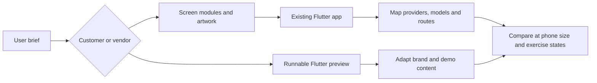

# Flutter screen and component map

Paths exported for a role match the original app’s `lib/` and `assets/` paths. Use `ui_kit.py show ROLE MODULE` for each entry point, cross-module imports and literal artwork. Include `foundation` when porting shared widgets and route definitions. Inspect the destination’s equivalent data provider and route contract before integrating presentation code.

| Customer scope | Select these modules | UI decisions carried from the source |
|---|---|---|
| Home, navigation and Browse | `foundation home categories search shops` | Delivery context → store → search → merchandising. Use category filters and shop profiles as separate destinations. Preserve actual category and store context. |
| Catalog card and product detail | `products reviews wishlist exchange` | Use consistent card slots. Give device condition, options, seller, QC report and price clear priority. Keep new, used and out-of-stock variants explicit. |
| Cart and buying | `cart checkout payments addresses purchase_limits` | Keep line items, totals, delivery and ordering actions distinct. Preserve stock limits, store hours, unavailable addresses and retry states from the host. |
| Fulfillment and after-sales | `orders tracking refund_requests support` | Make status and next step visible. Choose timeline, return form or chat from the order state. Keep order review and return actions conditional. |
| Sell, exchange, repair and auction | `sell_phone exchange repair auctions` | Start with the requested device or lot. Carry device identity and quote or bid status through each step. Preserve revision, comparison and confirmation screens. |
| Identity and account | `auth splash profile location notifications wallet business_account ledger` | Keep phone entry and OTP focused. Persist context across auth and permission screens. Keep security-sensitive actions with their existing host flow. |
| Additional engagement | `scratch_card spin_wheel tutorials nav_button` | Show optional features in the intended placement and preserve availability or eligibility. |

| Vendor scope | Select these modules | UI decisions carried from the source |
|---|---|---|
| Home dashboard | `foundation home` | Blue-to-violet identity band, stats, Quick Actions, demand, Needs Action, abandoned carts, live auctions and campaigns, then marketplace. Use information density and actionable status to decide what gets above-the-fold space. |
| Navigation | `foundation home profile campaigns` | Current bottom tabs are Home, Products, Marketplace, Auction and Repair. Profile and Campaigns come from the header and actions. Trust the bundled router and current nav widget over earlier profile screenshots. |
| Listings and inventory | `products` | Preserve channel, condition, stock and QC indicators. Keep listing edit, media edit, add and bulk-upload flows distinct. Provide recovery for partial forms and media failures. |
| Wholesale and demand | `wholesale demand my_orders` | In wholesale cards show per-unit price, minimum order quantity and stock. Start Add at the minimum. Preserve quote, payment and tracking routes for demand. |
| Orders, returns and recovery | `orders returns abandoned_carts` | Preserve status, age, seller task and primary action. Keep recovery reminders and order mutations in their proper routes. |
| Repair and acquisitions | `repairs repair_book sell_leads` | Separate work received by the vendor from repairs the vendor books. Show device, quote, readiness and handover state at the action point. |
| Auction and promotion | `auctions campaigns deals` | Preserve inventory, bid phases, campaign previews, expiry and actionable status. Keep live status separate from a card’s display timer. |
| Business and account | `auth business_profile profile store_settings subscription wallet payouts support splash` | Keep onboarding, identity/KYC, wallet and payout verification, and support distinct. Show what the business must complete before enabling the affected action. |

Typical picks are `export customer DEST foundation home products categories art:loading art:nav` for the storefront and `export vendor DEST foundation home products wholesale art:icons art:3d/new` for the vendor hub. Add feature-specific art folders when a component constructs names dynamically. The export includes a JSON inventory of selected paths and imports. The runnable preview provides local browse, product and cart interactions plus a vendor Home and Marketplace. Further screens retain their original source and need the destination app’s providers and routes.
